<!--
  - SPDX-FileCopyrightText: 2026 Nextcloud GmbH and Nextcloud contributors
  - SPDX-License-Identifier: AGPL-3.0-or-later
-->

<p align="center">
  <picture>
    <source media="(prefers-color-scheme: dark)" srcset="img/app.svg">
    
  </picture>
</p>

<h1 align="center">Intrusion detection for Nextcloud</h1>

<p align="center">
  <strong>Stops the password and stolen-login attacks that brute-force protection misses,<br>and explains every decision in plain words.</strong>
</p>

<p align="center">
  <a href="https://www.gnu.org/licenses/agpl-3.0.html"></a>
</p>

> **Status:** early preview. Built for Nextcloud 36; the core changes it needs are in review.

<picture>
  <source media="(prefers-color-scheme: dark)" srcset="screenshots/overview-dark.png">
  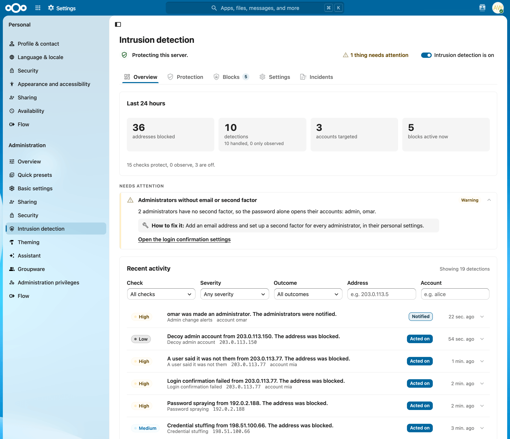
</picture>

- **Sees what a firewall can't.** Your Nextcloud knows accounts, app passwords, second factors, share links and login requests. This app uses that to catch password spraying across hundreds of addresses, a correct password followed by a failed second factor, a phished "connect a device" request and an account being taken over.
- **Answers in proportion.** It blocks an address for hours, asks for one more proof at login, ends a session or requires a new password. Every check can be set to Off, Observe or Protect.
- **Brings your users in.** "Was this you?" lets people tell Nextcloud that something was not them, and a short checklist helps them secure their account.
- **Explains itself.** Every detection says what happened, why it counted as an attack and what Nextcloud did, with the real numbers filled in.

Think of it as *Entra ID Protection for your own server*: identity-aware threat detection that runs inside Nextcloud, with no external service.

---

## Contents

- [Why](#-why)
- [How it works](#-how-it-works)
- [What it catches](#-what-it-catches)
- [Safe by default](#-safe-by-default)
- [For your users](#-for-your-users)
- [For admins](#-for-admins)
- [Privacy by design](#-privacy-by-design)
- [Light on resources](#-light-on-resources)
- [Getting started](#-getting-started)
- [Requirements](#requirements)
- [FAQ](#-faq)
- [Contributing and security](#contributing-and-security)

## 🎯 Why

Nextcloud's brute-force protection slows down guessing from **one** address. Firewalls, fail2ban, CrowdSec and web application firewalls see addresses and URLs. Today's attacks are built to slip past both:

- A **botnet** sends one or two attempts per address, so no single address ever looks suspicious.
- **Password spraying** tries one common password, such as `Summer2026!`, against every account it knows.
- An attacker who already **has the password** from a breach or a phishing page needs only one more step: guess the second-factor code, get a login request approved, or use a copied app password.
- Once inside, an intruder **makes the account their own**: a new email address, the second factor turned off, a fresh app password.

None of this shows up in an access log as anything unusual. All of it is visible to Nextcloud, because Nextcloud knows which account, which password, which second factor and which session was involved. This app watches exactly that, inside Nextcloud, and works alongside brute-force protection and the tools you already run.

## 🧭 How it works

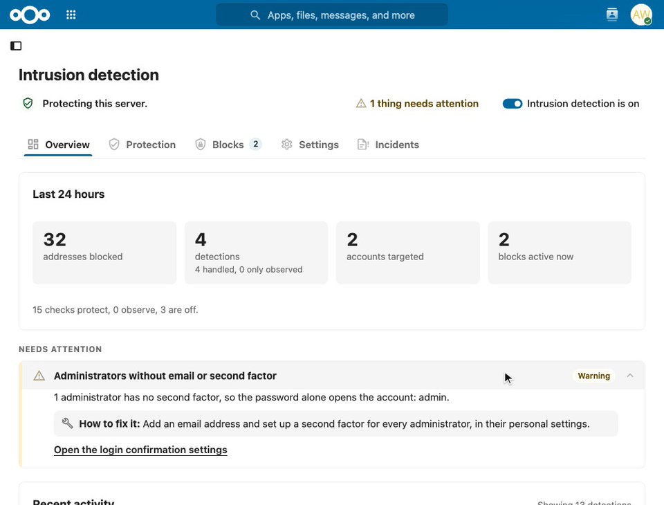

*A bot tries passwords for six accounts. Blocked at the 10th failure, and explained.*

1. **Record.** Failed logins, share link accesses, password reset requests, logins, security changes and admin changes are recorded. Normal requests get only a few quick checks (is the address blocked, is the path a trap, does the address look like an injection probe); the real work happens on failures, logins and in background jobs.
2. **Compare.** Each check compares what it sees with its limits, for example *10 failed logins for at least 5 different accounts from one address within 10 minutes*. An **address risk score** lowers the limits for addresses that already look suspicious, such as one that hit a trap URL or uses a scripting library.
3. **Decide.** A check in **Observe** only records what it would have done. A check in **Protect** acts.
4. **Respond in proportion.** Responses depend on the check: block the address, ask for extra confirmation at login, end a session, revoke an app password, require a new password, pause reset emails, or tell the user, the share owner and the admins.
5. **Escalate.** A first block lasts 4 hours. If the same address is blocked again within 30 days, the next block lasts 1 day, then 7 days. When 3 addresses of the same /24 network are blocked within 24 hours, the whole network is blocked. IPv6 addresses are blocked with their /64.
6. **Check the safety valves first.** Before any automatic block, the app checks whether the address is shared by many people, belongs to an administrator or is on the brute-force allowlist (see [Safe by default](#-safe-by-default)).
7. **Explain and tell.** The detection is stored with its numbers, so the Overview, notifications, emails and `occ` can say exactly why it happened. Blocked visitors see a short reference such as `K7Q2-MPXA` that the admin can look up.

## 🔎 What it catches

18 checks, in four groups. Most of them only work *because* they run inside Nextcloud. Their limits count over minutes and hours, so an attack spread thinly over days ("low and slow") stays below them; strong passwords and a second factor are the answer to that.

### Logins and passwords

| Check | What it notices | Default | What happens |
|---|---|---|---|
| **Password spraying** | One password fails for at least 5 different accounts within an hour, from any number of addresses. | Protect | Blocks the addresses that sprayed, remembers the password as attacked, asks for confirmation and a new password if someone logs in with it, tells the admins and the user. |
| **One account attacked from many places** | One account fails 10 times from at least 5 addresses within an hour. | Protect | Every password login to the account needs confirmation for 24 hours. Tells the user and the admins. |
| **Correct password, then a failed second factor** | The password was right, but the second factor failed 3 times in one login (or 5 times within an hour). | Protect | Ends that session, blocks the address, requires a new password, tells the user and the admins. |
| **Credential stuffing** | One address fails 10 times for at least 5 accounts within 10 minutes, or the whole server sees a botnet: 100 failures from 20 addresses for 20 accounts. | Protect | Blocks the address, marks it so a later successful login needs confirmation, tells the admins. |
| **Password known from data breaches** | A user logs in with a password from public breach lists. | Off (opt-in) | Asks for confirmation, requires a new password, tells the user. |

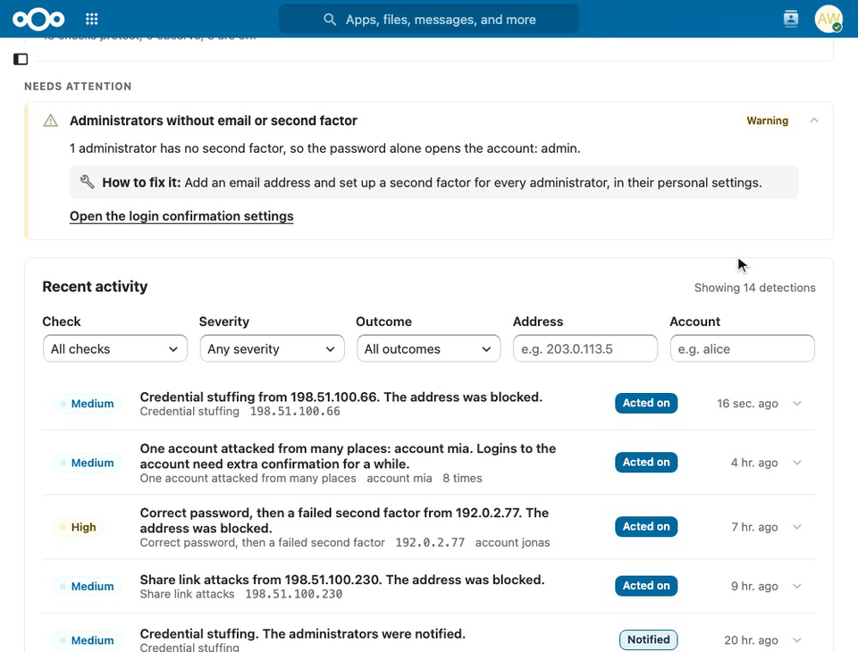

*One password, eight accounts, eight addresses. No single address looks suspicious, but the pattern does.*

<details>
<summary><strong>A detection, explained</strong> (screenshot)</summary>
<br>

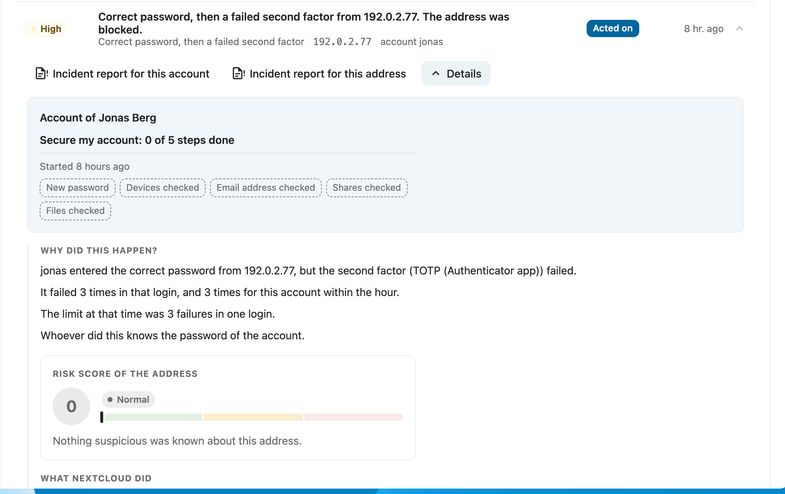

</details>

### Sharing

| Check | What it notices | Default | What happens |
|---|---|---|---|
| **Share link attacks** | One address opens 10 share links that don't exist within 10 minutes, or keeps guessing the password of one share. | Protect | Blocks the address. When one share's password is guessed from many addresses, the person who shared it is told. A server that opened a federated share of yours within the last day is only reported. |
| **Password reset abuse** | One address asks "Forgot password" for many different accounts, or one person is flooded with reset emails. | Protect | Blocks the probing address, or pauses reset emails to the flooded account and tells the person. |

### Scanning and probing

| Check | What it notices | Default | What happens |
|---|---|---|---|
| **Trap URLs** | A visitor who is not logged in asks for `/wp-login.php`, `/.env`, `/phpmyadmin` or another path no Nextcloud client ever requests. | Protect | Blocks the address at once. Most paths reach Nextcloud as they are; hidden paths such as `/.env` on nginx, and `.php` paths on Apache with PHP-FPM, need a one-time web server rule from the Blocks tab. |
| **Decoy admin account** | A login attempt with a reserved name, such as `administrator` or `root`, that no account uses. The app reserves the usual names when it is installed, leaving out existing accounts. | Protect | Blocks the address at once. |
| **Decoy app passwords and tokens** | Someone uses a fake credential you planted, say in an old script or a wiki page. | Protect | Blocks the address for 7 days and tells the admins where the decoy was planted. Acts even in learning mode. |
| **SQL injection and encoded payloads** | Database commands or base64-hidden attack code in web addresses and form fields. | Protect for visitors, Observe for logged-in users | Blocks the address. |
| **Known bad addresses** | A request from a network on a blocklist you switched on, such as Spamhaus DROP. | Off (opt-in) | Refuses the request with an error page and a reference. |
| **Hosting and Tor networks** | A password login from a cloud provider or a Tor exit node, using lists you switched on. | Protect (does nothing until a list is on) | Asks for extra confirmation at login. |

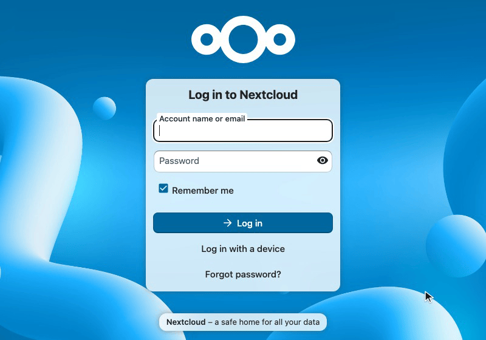

*A scanner tries the usual admin name, and is blocked on the spot with a reference it can quote.*

### Accounts and administration

| Check | What it notices | Default | What happens |
|---|---|---|---|
| **Login request phishing** | A "connect a device" login request was started on one network and approved on another, or long after it was started. | Protect | Disconnects the new device for high ratings, asks the user "Was this you?", tells the admins. |
| **Account takeover sequence** | Several security changes (email, password, second factor, app passwords) shortly after a risky login. | Protect | Emails a one-time "This wasn't me: lock my account" link to the *previous* email address after an email change, asks the user, tells the admins. |
| **Stolen app password or session** | One app password or session is used from two networks at the same time. | Protect (needs a memory cache) | Asks the user "Was this you?" and tells the admins. Revoking the credential can be switched on. |
| **Admin change alerts** | Someone got administrator rights, an app was switched on or off, or a watched security setting changed (also in `config.php`). | Protect | Tells every admin, including the one who made the change. A second admin's approval for new admins can be switched on. |
| **Directory scraping** | A logged-in account reads the user directory faster than a person could. | Protect (needs a memory cache) | Answers the account's directory requests with "too many requests" for a while, and tells the admins. |
| **Administrators outside the trusted networks** | An administrator (the admin group or delegated administration) logs in with the password from outside your trusted networks (office, VPN). | Off (opt-in) | Asks for the second factor, an email code or another admin's approval; a remembered device is not enough. Apps that send the password are refused; apps with app passwords are not affected. |

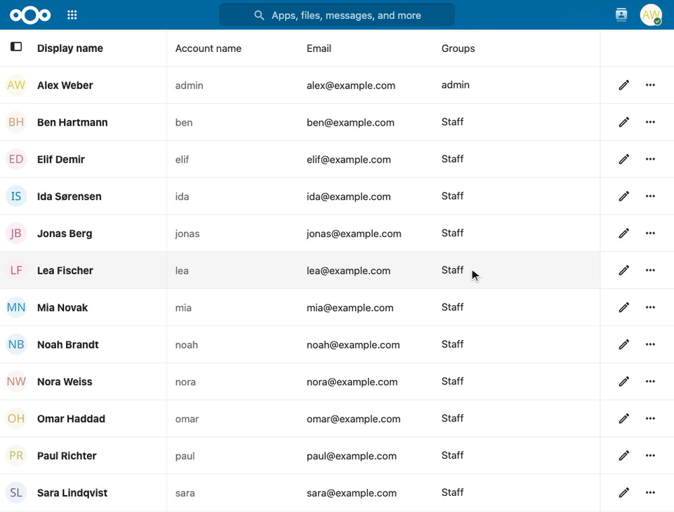

*Someone makes Omar an administrator. Every admin is told at once, on the dashboard and by email.*

## 🛟 Safe by default

An app that blocks people has to be careful about *whom* it blocks.

- **Off, Observe, Protect for every check.** Observe shows exactly what Protect would have done, so you can try a check before you trust it.
- **Learning mode first.** When you first enable the app, it observes for 7 days. Checks set to Protect only record what they would block; earlier blocks, blocks you add by hand, a user's "No, it was not me", decoys and reserved names still act. You can end, extend or restart learning at any time.
- **Protection levels.** *Relaxed*, *Recommended* (the default) or *Strict* sets the limits of every check at once: Strict fires at half the usual counts with blocks twice as long, Relaxed the other way round. Modes and responses stay as they are, and every number can still be changed by hand.
- **Shared addresses are never blocked automatically.** An address from which at least 5 different people with established accounts (at least 3 days old, or administrators) logged in successfully in the last 24 hours, such as an office network or a reverse proxy, is not blocked. You are told instead.
- **Admins' own addresses are spared.** Checks never block an address an administrator logged in from in the last 7 days, except for trap URLs and injection probes. The admin page refuses to block your own address. Addresses on the brute-force allowlist and the server's own addresses are never blocked.
- **People who mistype are not attackers.** Limits count different accounts, not single typos. When a password spray is caught, addresses that tried the password for only one account are not blocked, and blocking for an attacked account needs at least 4 different passwords from one address, so a device with an old saved password is left alone.
- **Blocks end on their own.** Every automatic block expires, and you can lift one early from its reference in seconds.
- **Every decision is explained**, in the admin page, in emails and with `occ intrusion:detections:explain`, so a wrong one is easy to recognise and undo.

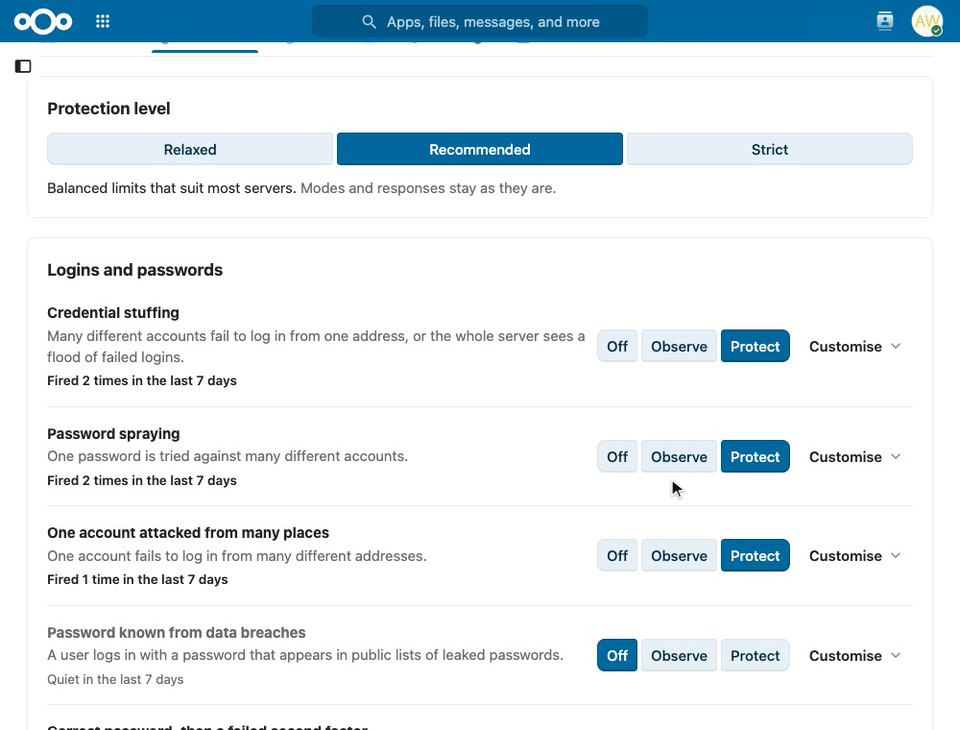

*One choice sets the limits of every check, and each check explains itself with the numbers in force.*

<details>
<summary><strong>How blocks escalate, and which addresses are never blocked</strong> (screenshot)</summary>
<br>

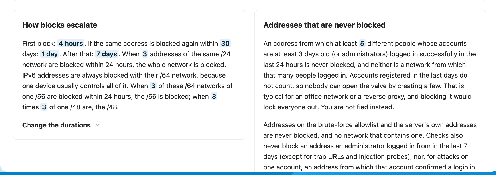

</details>

## 🙋 For your users

Security works better when the account owner can say "that wasn't me". Users find everything under **Personal settings → Security → Account protection**.

**Login confirmation.** When a password login looks risky, for example because the account is under attack, the address took part in an attack, or the password was sprayed or breached, Nextcloud asks for one more proof before letting the login in:

1. the user's **second factor**, if they have one;
2. a **remembered device**: after a confirmed login, users can tick "Remember this device" (kept 180 days after last use; never enough when the password itself is at risk, or for an administrator outside the trusted networks);
3. a 6-digit **email code**, valid for 10 minutes, with 5 tries;
4. optionally, **approval by an administrator** (off by default).

Apps that log in with an app password are never interrupted.

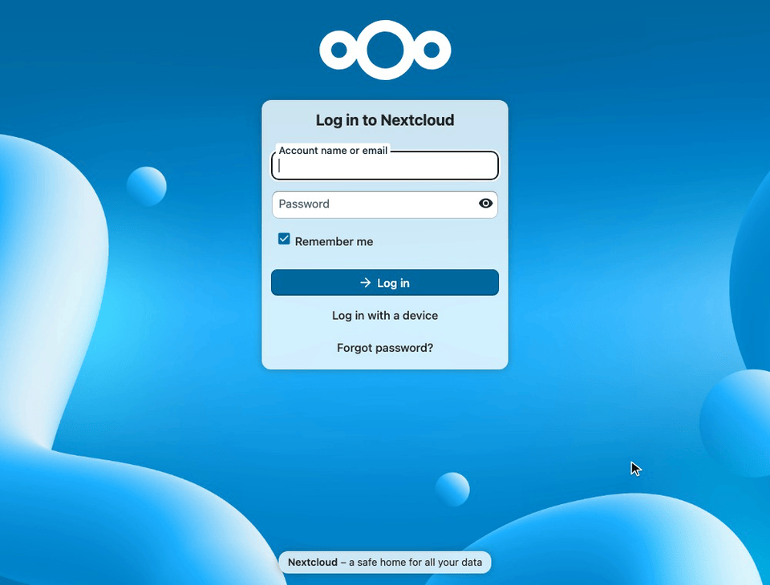

*Mia's account was attacked today, so even the right password needs one more proof.*

**"Was this you?"** When Nextcloud sees something it cannot check by itself, such as a login that was not confirmed, a device connected from another network or a credential used in two places, it asks the account owner. The question appears on the personal page and as a notification.

- **"No, it was not me"** ends the sessions and app passwords that came with the event, blocks the address it came from, requires a new password if the password was involved, and tells the admins. It only does all that from a login that proved more than the password, so an intruder who knows only the password cannot use it. From the Nextcloud desktop and mobile apps, or after a login with just the password, it tells the admins, and the question stays open.
- **"Yes, it was me"**, from a login that proved more than the password, trusts that network for the user for 30 days.

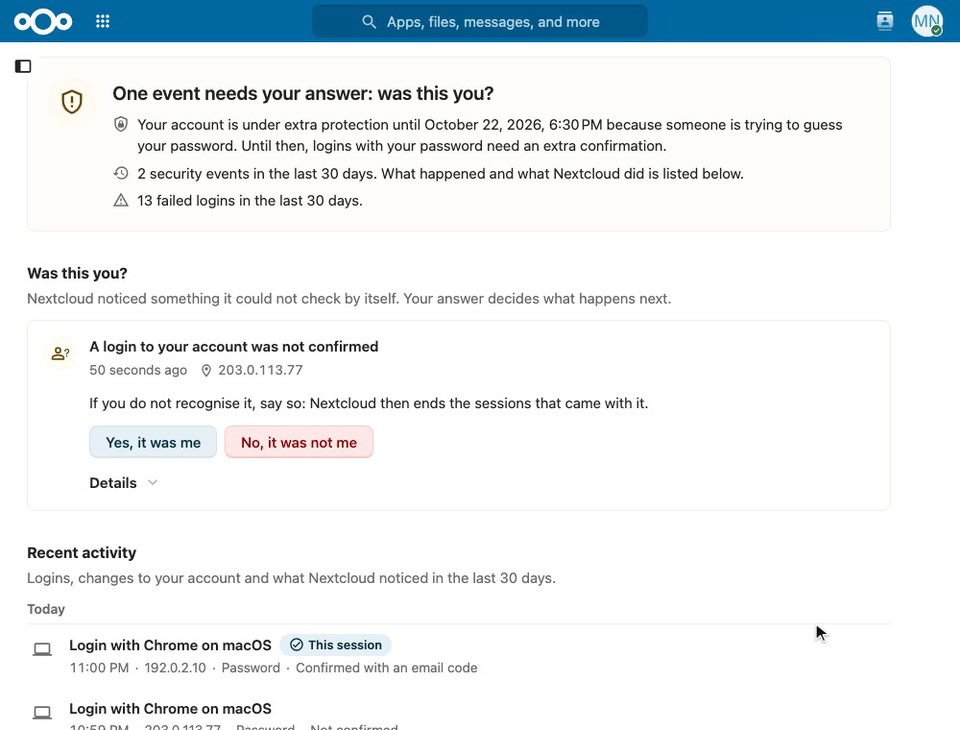

*Mia says a login was not hers. The sessions end, the address is blocked and the admins are told.*

**Secure your account.** After a "No", a short checklist walks the user through the next steps: change the password, check devices and sessions, turn on two-factor authentication, check the email address and profile, check recent shares and file changes.

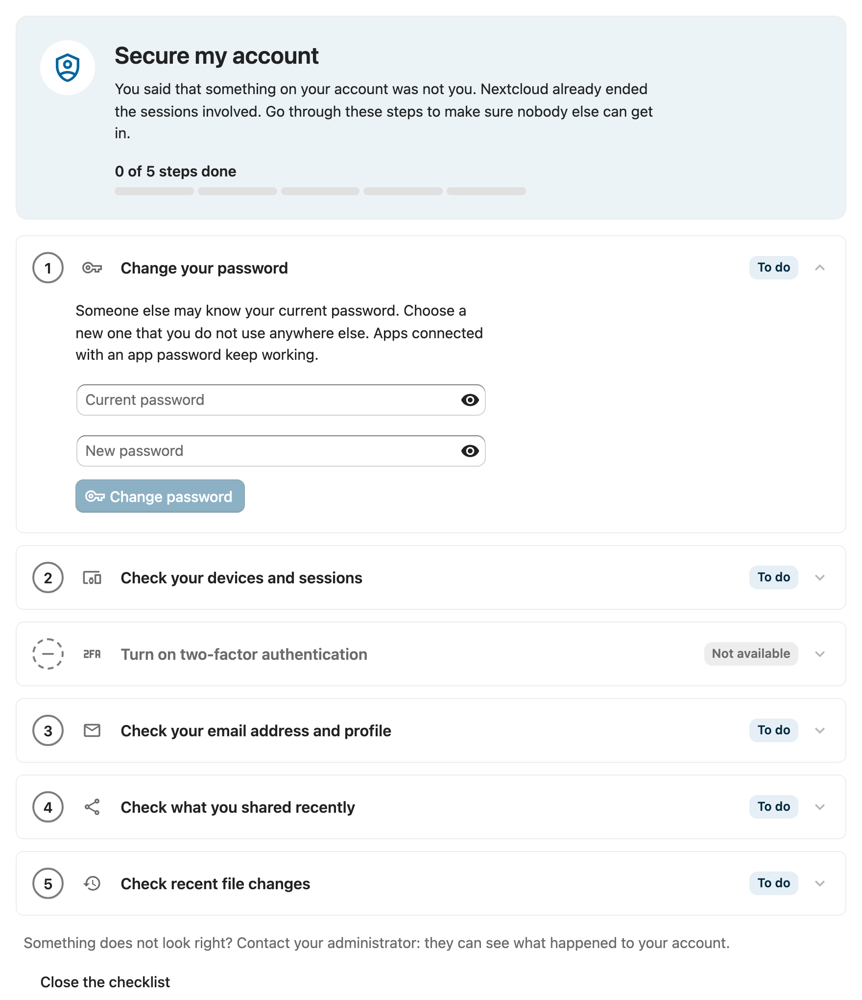

**Account protection page.** Users also see their recent logins and security events of the last 30 days, the failed logins, their remembered devices and trusted networks, and a button to log out other browsers. Admins can hide this page.

## 🧰 For admins

Everything lives under **Administration settings → Intrusion detection**, in five tabs: Overview, Protection, Blocks, Settings and Incidents.

**Overview.** What happened in the last 24 hours, what needs your attention, and every detection with its explanation. Filter by check, severity, outcome, address or account.

**Block references.** A blocked visitor sees a reference such as `K7Q2-MPXA`. Paste it into the lookup box to see the block, why it happened, and lift it with a note.

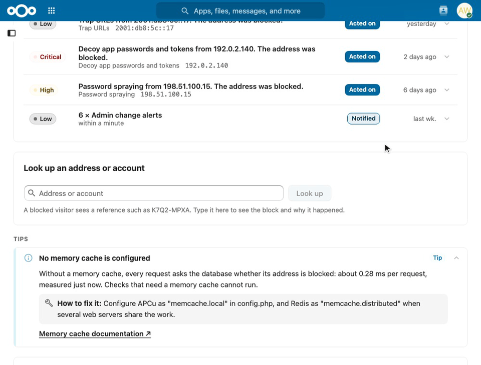

*A blocked visitor sends a reference. The admin sees what was blocked and why, and lifts it with a reason.*

**Blocks, blocklists and traps.** All active blocks with their level and expiry, block by hand, and manage blocklists, decoy credentials, reserved names and trap paths.

<details>
<summary><strong>Blocks tab</strong> (screenshot)</summary>
<br>

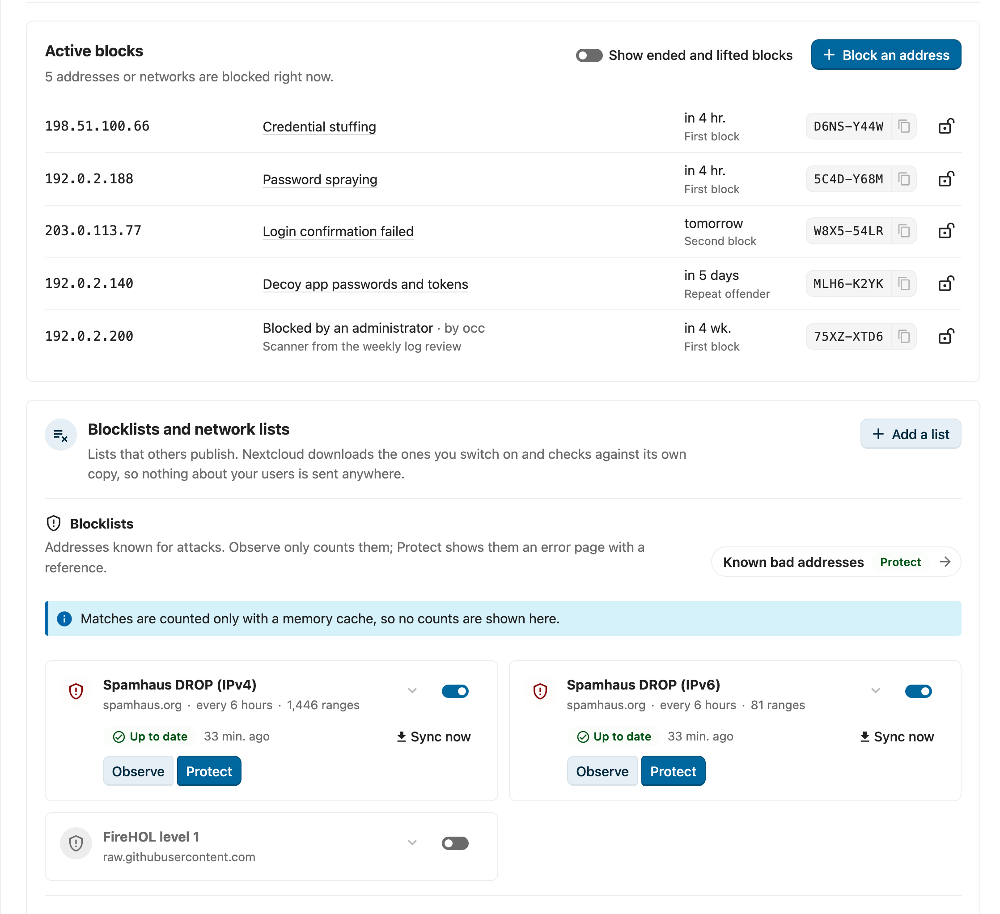

</details>

**Incident reports.** One timeline of everything Nextcloud knows about an account or an address over a period of up to 90 days: logins, detections, blocks, security changes, app passwords, shares and activity. It lists the kinds of data that may be affected, which helps with a breach notification. Reports are built when you ask for them and never stored. Print them, save them as PDF from the browser, or download them as an HTML page or JSON.

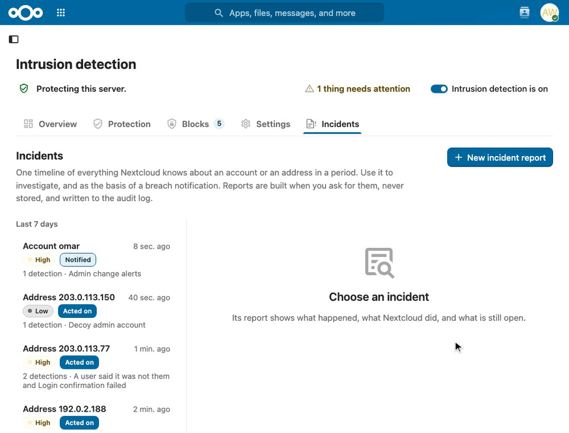

*Everything about one account on one timeline, ready to print or download.*

**Blocklists.** Spamhaus DROP (IPv4 and IPv6) and FireHOL level 1, plus network lists for Amazon Web Services, Google Cloud, Oracle Cloud, DigitalOcean and Tor exit nodes. All are off until you switch them on; you can add your own `https://` lists.

**Firewall export.** Write the active blocks to files your firewall reads, so blocked addresses are dropped before they reach the web server: `bans.txt`, an nftables script (`bans.nft`), an `ipset restore` script (`bans.ipset`) and an append-only `bans.log` for fail2ban. The admin page shows ready-made nftables, ipset, fail2ban and systemd snippets. The export directory can only be set in `config.php` (`intrusion_detection.export_dir`), and the app never runs a firewall command itself.

**Administrators from trusted networks only.** One switch in the login confirmation settings: a password login of an administrator from outside your trusted networks (office, VPN) then needs the second factor, an email code or, if you switched it on, another admin's approval. A remembered device is not enough, because the point is the network. Apps with app passwords are not affected. "Needs attention" warns you when the list of trusted networks is empty, or when an administrator has neither an email address nor a second factor, so nobody is locked out by surprise. `occ` keeps working from the server.

**Notifications and digest.** Admins in the chosen groups get a notification at most once per check, address and hour, and an email for severity High and above. A weekly digest (Monday 08:00, or daily, or off) sums up how each check did and what is still open.

<details>
<summary><strong>Notification and digest settings</strong> (screenshot)</summary>
<br>

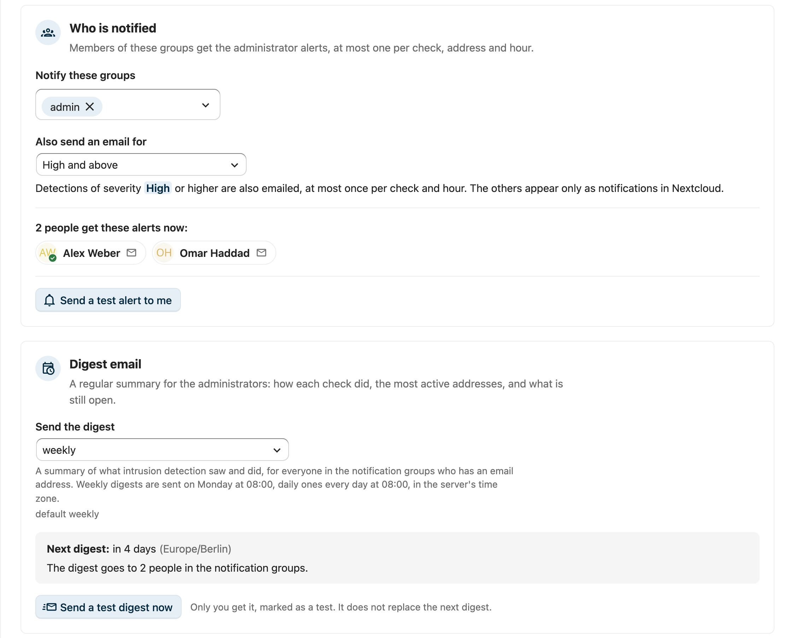

</details>

**Dashboard widget.** Logins waiting for your approval, the current status, the last 24 hours in numbers and the latest serious detections, right on the Nextcloud dashboard.

**Webhooks.** With Nextcloud's Webhooks app, three typed events can go to a chat room, a ticket system or a SIEM: `DetectionCreatedEvent`, `BanCreatedEvent` and `BanLiftedEvent`. Payloads never contain passwords, tokens or other secrets; whether they include the attacking address is up to you.

**OpenMetrics.** Six metrics for Prometheus: `intrusion_detections_total`, `intrusion_bans_active`, `intrusion_guard_seconds`, `intrusion_learning_mode`, `intrusion_blocklist_ranges` and `intrusion_approvals_pending`.

**Audit log.** Blocks, lifts, setting changes, learning mode and incident reports are written to Nextcloud's audit log (with the Auditing / Logging app).

**Command line.** 27 `occ` commands cover everything the admin page does, for hosters and scripts:

```sh
occ intrusion:status                          # what it is doing right now
occ intrusion:checks:list                     # every check with its mode and responses
occ intrusion:checks:set password_spraying --mode=observe
occ intrusion:checks:explain credential_stuffing
occ intrusion:simulate password_spraying      # what a check would do, without recording anything
occ intrusion:bans:list
occ intrusion:bans:lift K7Q2-MPXA --note="Our own scanner"
occ intrusion:detections:explain 2367
occ intrusion:report --user=mia --format=html > mia.html
occ intrusion:user mia                        # what applies to an account, and lift it
occ intrusion:export:write                    # write the firewall files now
occ intrusion:benchmark                       # measure the cost per request
```

<details>
<summary><strong>All 27 commands</strong></summary>
<br>

| Command | Purpose |
|---|---|
| `intrusion:status` | Show what intrusion detection is doing: mode, learning period, prerequisites, cost and counts |
| `intrusion:benchmark` | Measure the cost of the request guards per request |
| `intrusion:learning` | Start, extend or end learning mode |
| `intrusion:checks:list` | List the checks with their mode and responses |
| `intrusion:checks:set` | Change the mode, responses or settings of a check |
| `intrusion:checks:explain` | Explain a check with its current settings |
| `intrusion:bans:list` | List blocked addresses and networks |
| `intrusion:bans:add` | Block an address, a /24 or an IPv6 /64 by hand |
| `intrusion:bans:lift` | Lift a block by its id, its reference or an address it covers |
| `intrusion:detections:list` | List recent detections |
| `intrusion:detections:explain` | Explain why a detection happened and what Nextcloud did |
| `intrusion:export:write` | Write the firewall export files now |
| `intrusion:blocklists:list` | List the blocklists and network lists with their sync status |
| `intrusion:blocklists:sync` | Download one list, or every enabled list, now |
| `intrusion:blocklists:set` | Switch a list on or off, change its mode or interval, or add your own |
| `intrusion:reserved-names` | List, add or remove reserved login names |
| `intrusion:trap-paths` | List the trap paths, or add and remove your own |
| `intrusion:simulate` | Show what a check would report and do for a synthetic attack |
| `intrusion:user` | Show and lift what intrusion detection applies to an account |
| `intrusion:decoys:list` | List the decoy credentials and when they were last used |
| `intrusion:decoys:create` | Create a decoy app password or token; the secret is shown once |
| `intrusion:decoys:delete` | Delete a decoy credential |
| `intrusion:payload:test` | Show how the injection probe check sees a URL or a parameter |
| `intrusion:approvals:list` | List requests waiting for an administrator's approval |
| `intrusion:approvals:decide` | Approve or reject such a request |
| `intrusion:report` | Write the incident report of an account or an address |
| `intrusion:users:no-confirmation` | List active accounts with neither a second factor nor an email address |

</details>

**On a phone, too.** The admin page works on small screens.

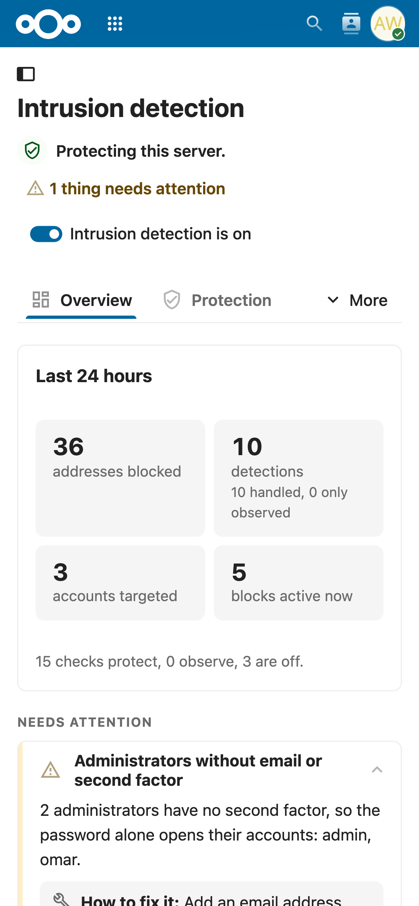

## 🔒 Privacy by design

- **Nothing leaves your server by default.** The app makes no outgoing connections unless you switch on a blocklist or the breached-password check. Downloading a list sends no data about your server or your users.
- **The breach check uses k-anonymity.** Only the first 5 characters of the password's SHA-1 hash go to the Have I Been Pwned range API, with padding, and the comparison happens on your server. It only checks logins through the login form, and it is off until you switch it on.
- **Secrets are never stored.** Passwords and account names in failed attempts, decoy secrets, email codes, lock links and remembered-device cookies are kept only as keyed fingerprints or hashes.
- **Everything has an expiry.** Failed attempts are kept 1 hour, successful logins 24 hours, detections, login history and security changes 90 days (configurable from 7 to 730), remembered devices 180 days after last use. A background job deletes them on time. Deleting an account deletes or anonymises its data.
- **The admin page lists all of it.** Settings → Data and privacy shows every kind of data the app keeps, why and for how long. IP addresses are stored as they are, because the admin needs them to recognise and lift blocks.

<details>
<summary><strong>What Nextcloud keeps</strong> (screenshot)</summary>
<br>

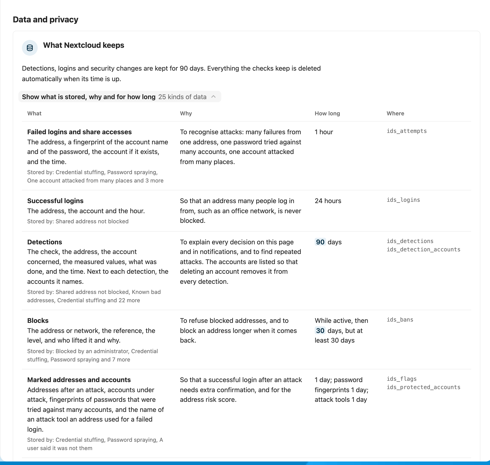

</details>

## ⚡ Light on resources

Normal requests get only a few quick checks. The expensive work happens on failed logins, successful logins and in background jobs. The test suite holds these quick checks to budgets:

| What | Budget in the tests | Measured on a developer laptop |
|---|---|---|
| Address check with a memory cache, with 100,000 blocklist ranges loaded | under 20 µs per request | about 7 µs |
| Stolen-credential check with a memory cache | under 20 µs per request | about 11 µs |
| Injection pre-filter on 10,000 URLs built from Nextcloud's routes | under 5 µs per URL | about 2 µs |
| Address check without a memory cache (from the database) | under 2 ms per request | about 0.15 to 0.35 ms |

The memory-cache rows use an in-memory stand-in for the cache; a networked cache such as Redis adds its own round trip.

A plain request in a new PHP process loads none of the checks and at most 45 of the app's classes. Measure your own server with `occ intrusion:benchmark`; with a memory cache, the app also samples 1 in 1,000 real requests and reports the cost in `occ intrusion:status` and the `intrusion_guard_seconds` metric.

## 🚀 Getting started

**You need Nextcloud 36** (in development) with the core changes this app hooks into. They are open as draft pull requests: [#65735](https://github.com/nextcloud/server/pull/65735), [#65736](https://github.com/nextcloud/server/pull/65736), [#65737](https://github.com/nextcloud/server/pull/65737), [#65738](https://github.com/nextcloud/server/pull/65738), [#65739](https://github.com/nextcloud/server/pull/65739), [#65740](https://github.com/nextcloud/server/pull/65740) and [#65741](https://github.com/nextcloud/server/pull/65741), plus one more small change to the DAV app.

Install from source:

```sh
cd /path/to/nextcloud/apps
git clone https://github.com/nextcloud/intrusion_detection.git intrusion_detection
cd intrusion_detection
npm ci && npm run build
cd ../..
php occ app:enable intrusion_detection
```

Then:

1. **Let it learn.** The app starts in learning mode for 7 days and records what it would have done. Look at the Overview now and then. To act at once, run `occ intrusion:learning --stop`.
2. **Check "Needs attention" and "Tips"** on the Overview. They tell you, for example, about admins without a second factor, a missing memory cache or a reverse proxy that is not set up as a trusted proxy.
3. **Route the trap paths** on nginx or on Apache with PHP-FPM: Blocks → Trap paths shows which paths your web server answers itself, and the rule that hands them to Nextcloud.
4. **Pick a protection level** on the Protection tab, and switch on blocklists or the breached-password check if you want them.
5. **Optional:** set `intrusion_detection.export_dir` in `config.php` to feed your firewall, and set up the Webhooks app to forward events.

## Requirements

- **Nextcloud 36** with the core changes listed above.
- **A memory cache** (APCu, Redis or Memcached) is strongly recommended. Without one, every request asks the database whether its address is blocked, and the *Stolen app password or session* and *Directory scraping* checks cannot run.
- **Email** so that users can confirm logins with a code and receive notices, and admins get alert emails and the digest. Without email, admins still get notifications in Nextcloud.
- **Background jobs**, ideally with system cron: they clean up old data, end learning mode, sync blocklists, write the firewall export, watch `config.php` and send the digest.
- **Correct reverse proxy settings** (`trusted_proxies`) if Nextcloud runs behind one, so that the app sees your visitors' real addresses.

## ❓ FAQ

<details>
<summary><strong>Will it lock out my users behind a NAT or an office network?</strong></summary>
<br>

It is built not to. An address from which at least 5 different people with accounts at least 3 days old logged in successfully in the last 24 hours is never blocked automatically; you are notified instead. You can change that number, put addresses on the brute-force allowlist, or set a check to Observe. Blocks expire on their own and can be lifted with the reference the user sees.
</details>

<details>
<summary><strong>I made administrators log in from trusted networks only and locked myself out. Now what?</strong></summary>
<br>

Log in from a trusted network, or turn the switch off on the server with `occ config:app:set intrusion_detection admin_trusted_networks_only --value=false`. `occ` is never asked for a confirmation.
</details>

<details>
<summary><strong>Does it phone home?</strong></summary>
<br>

No. It only connects out when you switch on a blocklist (a plain download) or the breached-password check (k-anonymous: only the first 5 characters of a hash are sent).
</details>

<details>
<summary><strong>Does it replace fail2ban, CrowdSec or a web application firewall?</strong></summary>
<br>

No, it complements them. They block cheaply at the edge; this app sees accounts, passwords, second factors, share links and sessions, which they cannot. Its firewall export can feed fail2ban, nftables or ipset, so its blocks are enforced before requests reach PHP. It also builds on Nextcloud's own brute-force protection and warns you if that is switched off.
</details>

<details>
<summary><strong>We log in with SAML or OpenID Connect. Is it still useful?</strong></summary>
<br>

Partly. When your identity provider checks the passwords, the password-guessing checks see little. Share link attacks, trap URLs, decoys, admin change alerts, blocklists and the other checks of requests that reach Nextcloud work as usual.
</details>

<details>
<summary><strong>What does it cost per request?</strong></summary>
<br>

With a memory cache, a few microseconds; see [Light on resources](#-light-on-resources). Run `occ intrusion:benchmark` on your own server to see the numbers.
</details>

## Contributing and security

- **Bugs and ideas:** please open an issue at [github.com/nextcloud/intrusion_detection/issues](https://github.com/nextcloud/intrusion_detection/issues). Pull requests are welcome; see the [Nextcloud contribution guidelines](https://github.com/nextcloud/.github/blob/master/CONTRIBUTING.md).
- **Security issues:** please do **not** open an issue. Report them through [HackerOne](https://hackerone.com/nextcloud), as described in the [Nextcloud security policy](https://nextcloud.com/security/).

## License

Intrusion detection is free software under the [GNU Affero General Public License v3.0 or later](https://www.gnu.org/licenses/agpl-3.0.html). The people, addresses and domains in the screenshots are fictional; the addresses come from the ranges reserved for documentation.
